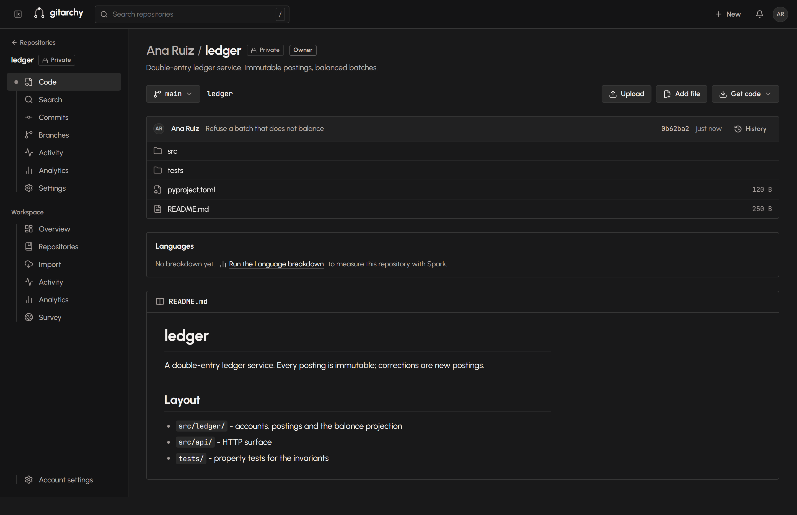
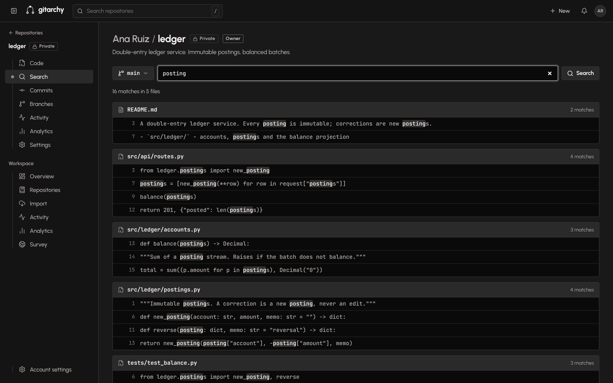
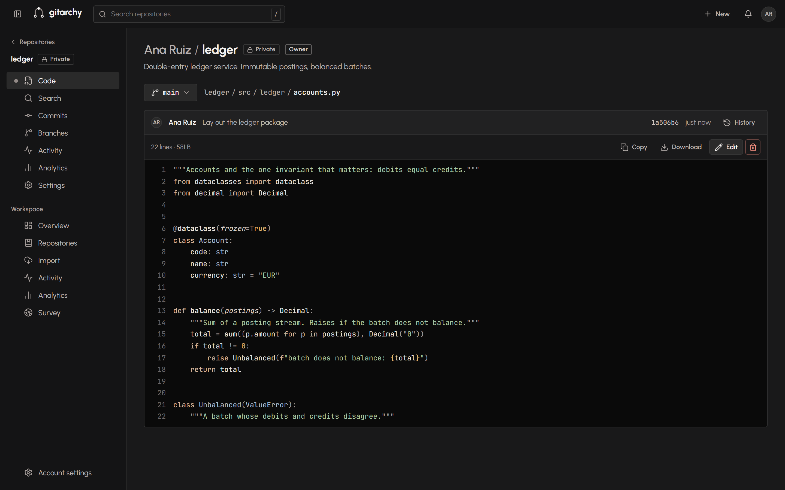
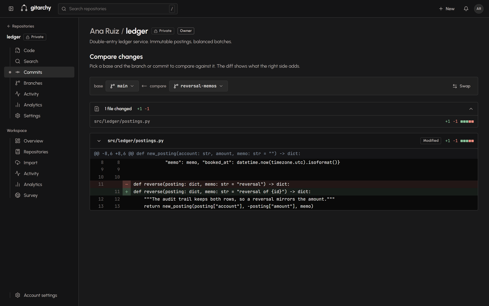
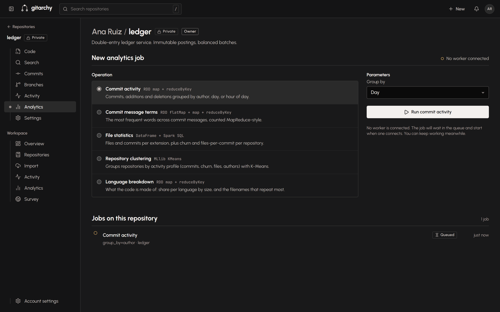
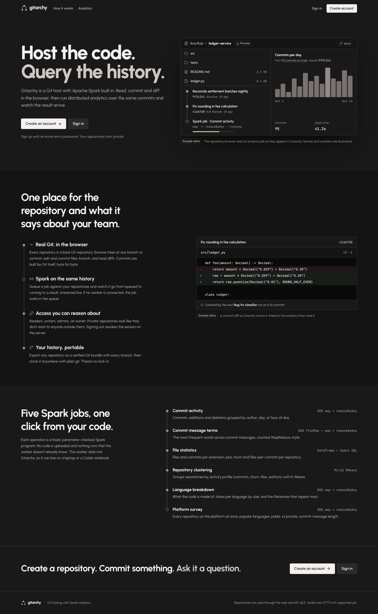
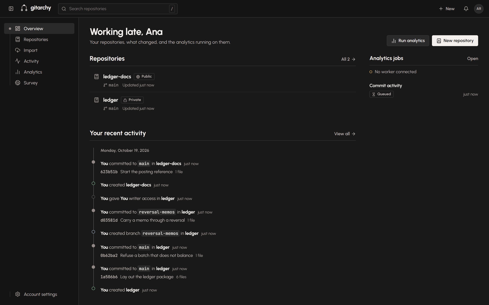
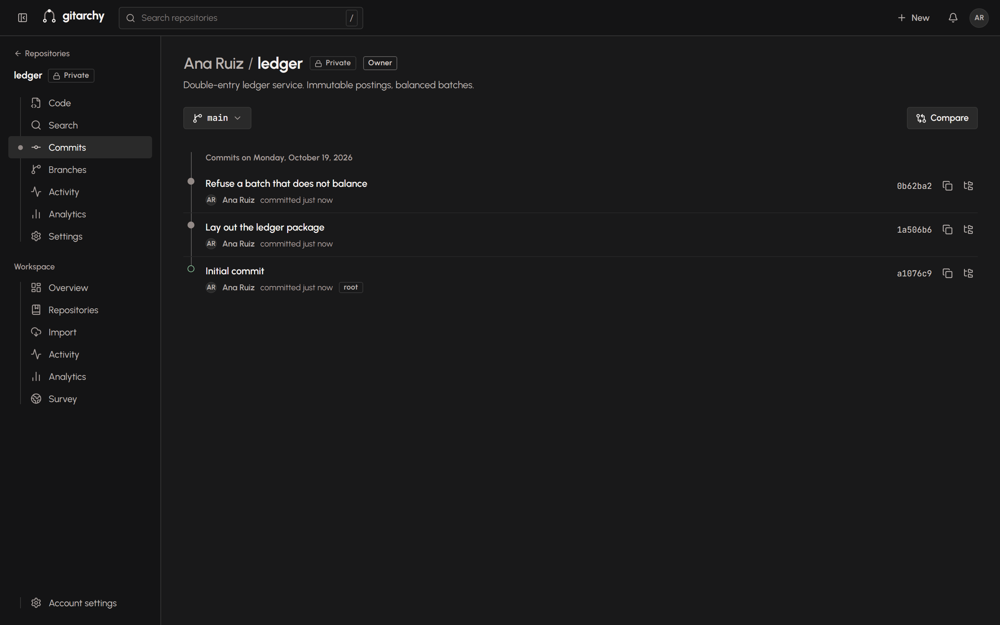
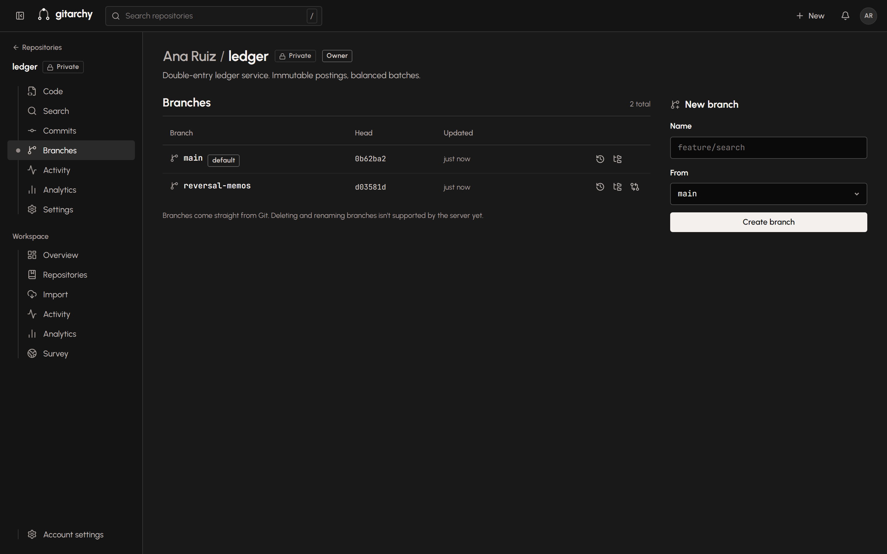
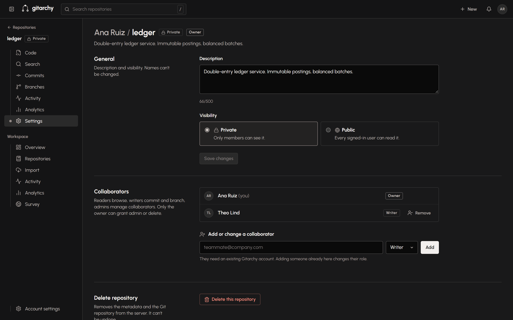

# Gitarchy

GitHub-style code host with Spark analytics built into the platform rather than bolted on
beside it. Users, repositories, roles, branches, files, commits, diffs, code search and activity — plus
distributed jobs that run over your own git history and stream their progress back to the page you started
them from.

Version control is the real `git` CLI. No GitHub or GitLab API is involved anywhere in the product.



## What it does

| | |
|---|---|
| **Hosting** | Public/private repositories, member roles (reader → writer → admin → owner), branches, a file browser with syntax highlighting, byte-exact commits from the browser, diffs between any two refs, and a per-repository activity feed. |
| **Code search** | `git grep` at any ref: literal, case-insensitive, text files only, grouped by file, each line linking into the blob. |
| **Analytics** | Five PySpark task types over your repositories — commit activity (RDD), commit-message terms (MapReduce), file statistics (Spark SQL), repository clustering (MLlib K-Means) and language breakdown — queued, dispatched to a connected worker, streamed back over a WebSocket. |
| **Import** | Pull a repository in from GitHub over OAuth, as a real clone. Export any repository as a verified `git bundle`. |
| **Access** | Argon2id + JWT with real logout revocation. A private repository answers 404 to non-members, so repository ids are not a capability. |

### Searching the code



### Reading a file and a diff

| File | Diff |
|---|---|
|  |  |

### Analytics, honestly

Jobs are asynchronous and slow, and a job needs a connected Spark worker. With no worker attached a job stays
`queued` and says so — that is a normal state the UI explains rather than hides.



<details>
<summary>More screens</summary>

| | |
|---|---|
| Landing |  |
| Dashboard |  |
| Commits |  |
| Branches |  |
| Members and roles |  |

</details>

## Architecture

```
Next.js (App Router)  ──REST + JWT──>  FastAPI  ──subprocess──>  real git (bare repos on disk)
                                          │
                                          ├── Astra DB (Cassandra)   metadata, users, jobs
                                          ├── R2                     bundles and uploads
                                          ├── Cloudinary             avatars
                                          └── WebSocket  <────────   Spark worker (Colab), connects out
```

Every git command runs as an argv list against a server-generated `--git-dir`; no working tree is ever checked
out, so content hooks and symlinks are never followed. The disk is a cache: the durable copy of each repository
is a mirror in object storage, pulled back on the next command if the disk is gone.

More detail: [backend/docs/architecture.md](backend/docs/architecture.md) ·
[backend/docs/api.md](backend/docs/api.md) · [backend/docs/security.md](backend/docs/security.md) ·
[backend/docs/deployment.md](backend/docs/deployment.md) · [DESIGN.md](DESIGN.md)

## Run it

Requirements: Python 3.12+, Node 20+, and **git** on `PATH`.

**Backend** (FastAPI, :8000)
```bash
cd backend
python -m venv .venv
source .venv/bin/activate        # Windows: .\.venv\Scripts\Activate.ps1
pip install -r requirements.txt
cp .env.example .env             # Windows: Copy-Item .env.example .env
uvicorn app.main:app --reload --host 127.0.0.1 --port 8000
```

`.env.example` ships `DATABASE_BACKEND=memory`, so it starts with zero cloud credentials (data is lost on
restart). API docs at http://127.0.0.1:8000/docs.

**Frontend** (Next.js, :3000)
```bash
cd frontend
npm install
cp .env.example .env.local       # NEXT_PUBLIC_API_BASE_URL=http://127.0.0.1:8000
npm run dev
```

**Spark worker** (optional; analytics stay queued without it)

Set `WORKER_TOKEN` in `backend/.env`, then run `backend/colab_worker/gitarchey_colab_worker.ipynb` in Colab.
See [backend/docs/colab-setup.md](backend/docs/colab-setup.md).

## Tests

```bash
cd backend && pytest                     # 182 pass; 9 skip (opt-in integration + Spark, which needs PySpark)
cd frontend && npm run typecheck && npm run lint
cd frontend && npm run test:e2e          # Playwright; needs both servers up
```

Screenshots in this README are regenerated from the running app — never mocked — with:

```bash
node scripts/capture_screenshots.js      # seeds a throwaway account, drives the real UI
```

## Status

- **Verified:** the backend unit suite, a live end-to-end run of all five Spark task types against the server,
  and a bundle export that clones back byte-identical under `git fsck`.
- **Not yet run against the real thing:** Astra DB (the CQL is unit-tested with a fake driver), R2, Cloudinary,
  a Render deployment, and a live Colab session.
- **Not implemented:** `git clone` / `fetch` / `push` over HTTP. The browser and the REST API are the only ways
  in or out of a repository today, apart from bundle export.
- There are no users, metrics or benchmarks to report, and none are invented here.
